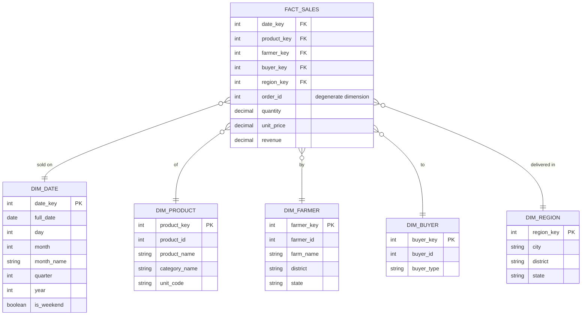

# Parallel, Distributed, NoSQL, Big Data, Warehouse and Cloud

These are **study topics** (brief §15). The marketplace runs on one MySQL
server; nothing in this file is implemented unless it says so. Each topic is
related to how a much larger version of the marketplace could use it.

## 1. Parallel databases

A parallel DBMS uses many CPUs and disks **inside one system** to answer
queries faster.

| Architecture | Shared | Example |
|---|---|---|
| Shared memory | CPUs share RAM and disks | a single large server (our MySQL container, on a small scale) |
| Shared disk | CPUs have own RAM, share disks (SAN) | Oracle RAC |
| Shared nothing | each node has own CPU, RAM, disk; nodes talk over a network | most data warehouses, Hadoop |

* **I/O parallelism** — split a table over several disks (round-robin, hash
  or range partitioning) so it is read in parallel. Range partitioning
  `orders` by `order_date` would let a yearly report read one partition.
* **Inter-query parallelism** — different queries run at the same time on
  different CPUs. MySQL already does this: one thread per connection; the
  farmer's sales report and a buyer's search run concurrently.
* **Intra-query parallelism** — one query is split across CPUs.
  * *intra-operation*: one operation in parallel, e.g. sorting 10 million
    order lines in 8 chunks and merging;
  * *inter-operation*: different operators of the same plan in parallel,
    e.g. scanning `order_item` while hashing `product` for a join (pipelining).
  MySQL 8.4 runs most queries on one thread (it parallelises a few things
  such as clustered-index `COUNT(*)` scans); analytic engines do far more.

## 2. Distributed databases

Data is stored on **several sites** connected by a network but appears as one
database.

* **Homogeneous** (same DBMS everywhere) vs **heterogeneous** (different DBMSs).
* **Fragmentation**
  * *horizontal*: rows split by a predicate — e.g. `orders` of Maharashtra on a
    Pune server, Karnataka on a Bengaluru server;
  * *vertical*: columns split — e.g. `users(user_id, name, email)` on one site,
    sensitive `password_hash` on a more protected one (the key is repeated so
    the fragments can be joined back).
* **Replication** — copies of a fragment on several sites (e.g. the product
  catalogue replicated to every region for fast reads; orders written to one
  primary).
* **Distributed query processing** — the optimizer also counts network cost;
  a **semi-join** ships only the join keys to the other site first to reduce
  transfer.
* **Distributed transactions** — **two-phase commit** (prepare, then commit)
  so an order that touches two sites commits everywhere or nowhere.
* **Benefits**: data close to users, survives a site failure, scales out.
  **Challenges**: network latency, partitions, keeping replicas consistent,
  harder transactions and backups.

A future design could keep regional OLTP databases for each state and a
central analytics warehouse fed from all of them (see §6).

## 3. Search index (Elasticsearch) — not implemented

Elasticsearch builds an **inverted index** (word → list of documents), which
is what "contains"-style search needs. Our `LIKE '%…%'` searches cannot use
a B+ tree index ([query_optimization.md](query_optimization.md), query C).
A search extension would index product name, description, category and farm
location, refreshed when a product changes. MySQL would stay the
authoritative store; the search index is a derived, rebuildable copy.

## 4. NoSQL

| Type | Data model | Example products | Marketplace use that would fit |
|---|---|---|---|
| Key-value | key → opaque value | Redis, DynamoDB | buyer's cart and session; cached catalogue pages |
| Document | JSON documents | MongoDB, Couchbase | notifications, product reviews with photos and varying fields |
| Column-family | rows with flexible column groups | Cassandra, HBase | huge append-only price/demand time series per market |
| Graph | nodes and edges | Neo4j | "buyers who bought from this farm also bought…" recommendations |

**BASE vs ACID.** NoSQL systems often choose **B**asically **A**vailable,
**S**oft state, **E**ventually consistent: replicas may briefly disagree but
converge. That is fine for a product view counter or recommendations, **not**
for stock and payments — selling stock you do not have is exactly the bug
ACID prevents ([transaction_demo.md](transaction_demo.md)).

**CAP theorem.** When a network **P**artition happens, a distributed system
must choose between **C**onsistency (refuse or wait) and **A**vailability
(answer, possibly with stale data).

* Order placement and stock → choose **CP**: better to show "try again" than
  oversell.
* Catalogue browsing and search → choose **AP**: showing a product list that
  is a few seconds old is acceptable.

## 5. Big Data and Hadoop

**Characteristics (the Vs):** Volume (years of daily mandi prices for every
crop and market), Velocity (prices and orders streaming in), Variety (CSV,
weather APIs, images), Veracity (noisy data), Value.

**Hadoop:**

* **HDFS** — files split into large blocks (128 MB) stored on many machines,
  each block replicated (3 copies by default). A *NameNode* keeps the
  metadata; *DataNodes* hold the blocks.
* **YARN** — schedules jobs on the cluster.
* **MapReduce** — the computation moves to the data:

```
Input lines:  2026-11-20, Pune, Tomato, 28
map(line)   → emit ((month, crop), price)            e.g. ((2026-11, Tomato), 28)
shuffle     → group all prices with the same key
reduce(key, prices) → emit (key, average(prices))     ((2026-11, Tomato), 29.4)
```

Use case: average monthly price per crop and region over ten years of
national market data, to warn farmers when today's price is unusually low.
Today the same question on our small data is one `GROUP BY` query.

## 6. Data warehouse, OLTP and OLAP

| | OLTP (our application) | OLAP (warehouse) |
|---|---|---|
| Purpose | run the business: orders, stock, payments | analyse the business: trends, comparisons |
| Typical query | touch a few rows by key, many writes | scan and aggregate millions of rows, read-only |
| Design | normalized (BCNF), many small tables | denormalized star schema |
| Data | current state | history, loaded periodically (ETL) |

**Proposed star schema** (documented design, not implemented):



* **Grain:** one row of `FACT_SALES` per order line of a non-cancelled order.
* **ETL:** a nightly job reads `order_item ⋈ orders ⋈ product ⋈ …` from the
  OLTP database, looks up or creates the dimension keys and appends the facts.
  Analytical aggregates are kept out of the transactional tables.
* **Star vs snowflake:** in a star schema each dimension is one wide,
  denormalized table (category name is copied into `DIM_PRODUCT`). A
  **snowflake** schema normalizes dimensions further (`DIM_PRODUCT →
  DIM_CATEGORY`, `DIM_REGION → DIM_STATE`): less redundancy, but more joins
  in every query. Warehouses usually prefer star for simpler, faster queries.

**OLAP-style queries.** Roll-up from category to grand total already runs on
the OLTP data (demo 12.6):

```sql
SELECT COALESCE(c.category_name, '== ALL ==') AS category, SUM(oi.line_total) AS revenue
FROM order_item oi JOIN orders o ON o.order_id = oi.order_id
JOIN product p ON p.product_id = oi.product_id JOIN category c ON c.category_id = p.category_id
WHERE o.order_status NOT IN ('REJECTED','CANCELLED','DELIVERY_FAILED')
GROUP BY c.category_name WITH ROLLUP;
```

| category | revenue |
|---|---|
| Fruits | 1,610.00 |
| Grains & Pulses | 23,050.00 |
| Vegetables | 2,680.00 |
| == ALL == | 27,340.00 |

On the star schema the typical operations would be:

* **Roll-up** month → quarter → year: `GROUP BY d.year, d.quarter WITH ROLLUP`
* **Drill-down** the reverse (year → month → day)
* **Slice** one dimension value: `WHERE r.state = 'Maharashtra'`
* **Dice** several: `WHERE d.year = 2026 AND p.category_name IN ('Fruits','Vegetables')`
* **Pivot** months as columns, categories as rows

## 7. Cloud databases and DBaaS

A **Database-as-a-Service** (Amazon RDS / Aurora for MySQL, Azure Database for
MySQL, Google Cloud SQL) runs MySQL for you.

| Concern | What the provider handles | What the team still owns |
|---|---|---|
| Availability | automatic failover to a standby replica in another zone | choosing multi-zone and paying for it |
| Backup | automated snapshots and point-in-time restore | testing restores (as our `restore.ps1` does) |
| Scalability | bigger instance with a click; read replicas | schema, indexes, queries |
| Security | encryption at rest and in transit, patching | users, grants, network rules, secrets |
| Cost | pay per hour/GB | sizing; stopping dev databases when unused |

The application would need only a different `db.url` in `db.properties`
(plus TLS) — the code is unchanged. Cloud deployment is **not** required for
this project; the Docker setup is the "local equivalent" and is what the
demonstration uses.
