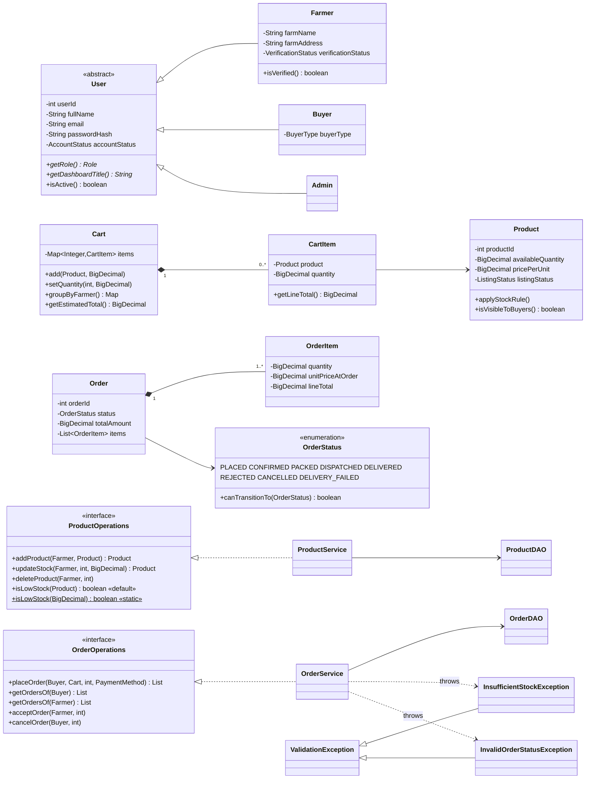
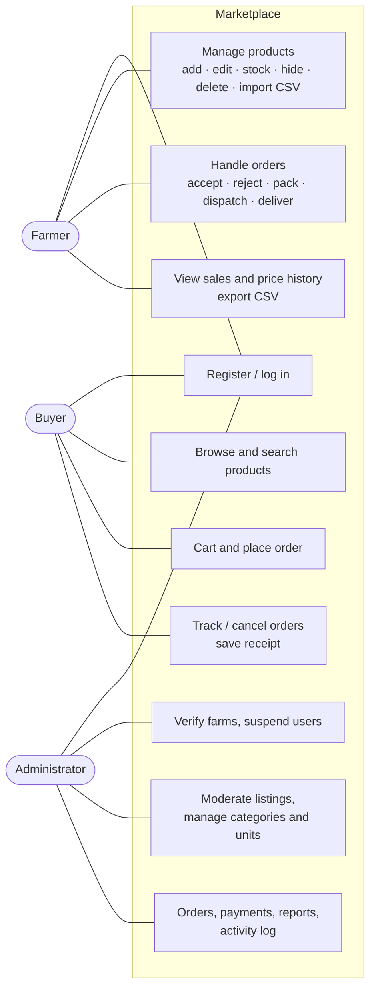

# Architecture and Class Design

## 1. Layers

```
┌──────────────────────────────────────────────────────────────┐
│  ui/        Swing screens (LoginFrame, dashboards, dialogs)   │  Event Dispatch Thread
│             - never contains SQL                              │
│             - long work runs in Async (SwingWorker)           │
├──────────────────────────────────────────────────────────────┤
│  service/   Business rules, validation, transactions          │  background threads
│             AuthenticationService, ProductService,            │
│             OrderService, AdminService, ReportService ...     │
├──────────────────────────────────────────────────────────────┤
│  dao/       SQL only, PreparedStatement only                  │
│             UserDAO, ProductDAO, OrderDAO, ReportDAO ...      │
├──────────────────────────────────────────────────────────────┤
│  config/    DatabaseConfig → JDBC connection (market_app)     │
├──────────────────────────────────────────────────────────────┤
│  MySQL 8.4  tables, constraints, views, routines, triggers    │  Docker container
└──────────────────────────────────────────────────────────────┘
       model/  plain objects passed between the layers
       util/   Csv, Formats, PasswordUtil, ReceiptFormatter
```

Rules: the UI calls services, services call DAOs, DAOs talk to MySQL. A
screen never opens a connection, and a DAO never shows a dialog. Each rule
has one owner (see [relational_schema.md §4](relational_schema.md#4-which-layer-owns-each-rule)).

## 2. Class diagram (model and service layer)



Notes on the design choices:

* **`User` is abstract.** A plain "user" never exists; every account is a
  `Farmer`, `Buyer` or `Admin`. `getRole()` and `getDashboardTitle()` are
  abstract and overridden (runtime polymorphism). `UserDAO.mapRow` builds the
  right subclass from the `role` column.
* **Abstract class vs interface.** `User` shares *state* (id, name, email),
  so it is an abstract class. `ProductOperations` / `OrderOperations` describe
  *capabilities* with no state, so they are interfaces; `ProductOperations`
  also shows a `default` and a `static` interface method.
* **Overloading.** `OrderOperations.getOrdersOf(Buyer)` and
  `getOrdersOf(Farmer)` — same name, chosen at compile time by argument type.
  Constructors are overloaded too (`ProductService()` and
  `ProductService(ProductDAO, PriceHistoryDAO)` for testing).
* **Encapsulation.** All fields are private; setters validate where it
  matters (`User.setFullName`). `Cart.setQuantity` is package-private on
  `CartItem` so only `Cart` can change quantities after its stock check.
* **Composition.** A `Cart` owns its `CartItem`s; an `Order` owns its
  `OrderItem`s.
* **Exceptions.** `ValidationException` (checked) carries a message meant
  for the user; `DataAccessException` (unchecked) wraps `SQLException`.

The UI layer has its own small hierarchy: `SidebarDashboard` (abstract) is
extended by `FarmerDashboard`, `BuyerDashboard` and `AdminDashboard`, which
only add pages and override the `onPageShown` hook.

## 3. Use cases



## 4. Threads

All database and file work runs off the Event Dispatch Thread through
[`ui/Async.java`](../src/main/java/ui/Async.java), a thin wrapper around
`SwingWorker`:

* `doInBackground()` runs the service call on a worker thread;
* `done()` runs on the EDT and updates the components;
* searches and detail panes keep a sequence number so a slow, out-of-date
  result never overwrites a newer one.

Swing components are only created and changed on the EDT
(`SwingUtilities.invokeLater` in `Main`).
