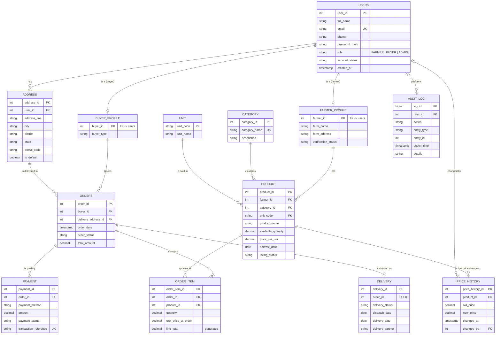
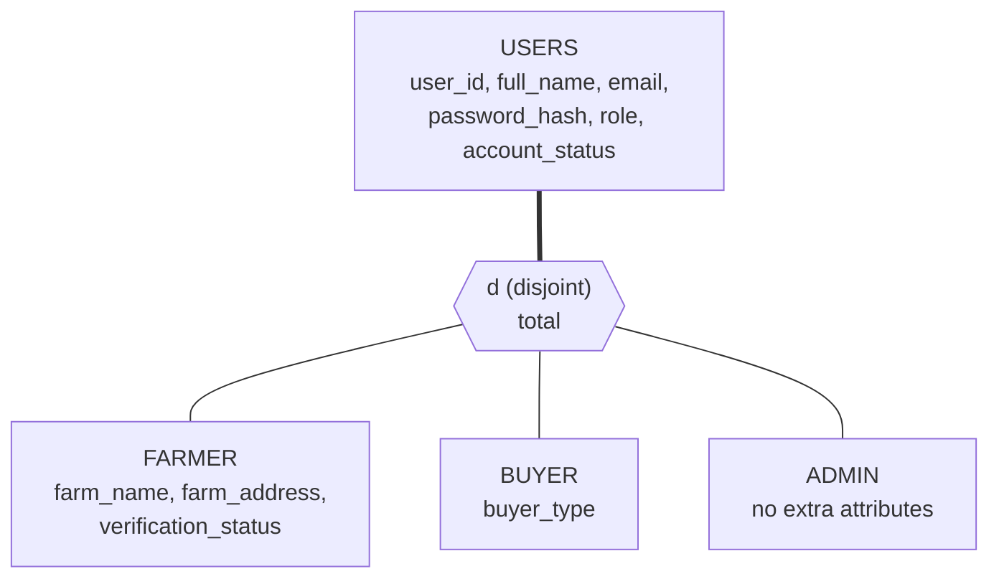

# ER Model

## 1. Design process

Requirements (§5 of the brief) → entities and relationships (this file) →
relational schema ([relational_schema.md](relational_schema.md)) →
normalization check ([normalization.md](normalization.md)) → SQL
([`01_create_schema.sql`](../database/01_create_schema.sql)).

## 2. ER diagram (crow's-foot notation)

## 3. Extended ER: specialization of USERS

* **Disjoint:** a user has exactly one role (`role` is the discriminator,
  `chk_users_role` allows one value).
* **Total:** every user is a farmer, buyer or admin.
* **Mapping strategy:** one table for the superclass plus one table per
  subclass *that has its own attributes*, sharing the primary key
  (`farmer_profile.farmer_id` is both PK and FK to `users`). `ADMIN` has no
  extra attributes, so it needs no table.
* The same idea appears in Java: abstract `User` with subclasses
  `Farmer`, `Buyer`, `Admin` ([architecture.md](architecture.md)).
* What the database cannot enforce by itself: that a `role = 'FARMER'` row
  always has a `farmer_profile` row. `UserDAO.insertFarmer` inserts both in
  one transaction, so the pair is created together or not at all. A product
  can still only point to a real farmer — constraint test C07 shows that a
  buyer's id is rejected as `farmer_id`.

## 4. Relationships, cardinality and participation

| Relationship | Cardinality | Participation | Notes |
|---|---|---|---|
| USERS – FARMER_PROFILE | 1 : 0..1 | user partial, profile **total** | specialization (shared PK) |
| USERS – BUYER_PROFILE | 1 : 0..1 | user partial, profile **total** | specialization |
| USERS – ADDRESS | 1 : N | address **total** | `ON DELETE CASCADE` |
| FARMER_PROFILE – PRODUCT | 1 : N | product **total**, farmer partial | a new farmer may have no products |
| CATEGORY – PRODUCT | 1 : N | product **total**, category partial | |
| UNIT – PRODUCT | 1 : N | product **total**, unit partial | |
| BUYER_PROFILE – ORDERS | 1 : N | order **total**, buyer partial | |
| ADDRESS – ORDERS | 1 : N | order **total** | address kept for history (`RESTRICT`) |
| ORDERS – ORDER_ITEM | 1 : 1..N | **both total** | an order needs ≥ 1 item (enforced by `OrderService`) |
| PRODUCT – ORDER_ITEM | 1 : N | item **total**, product partial | |
| ORDERS – PAYMENT | 1 : N | payment **total**, order partial | retries/refunds possible |
| ORDERS – DELIVERY | 1 : 0..1 | delivery **total** | `UNIQUE(order_id)` makes it 1 : 0..1 |
| PRODUCT – PRICE_HISTORY | 1 : N | history **total** | written by trigger |
| USERS – AUDIT_LOG | 0..1 : N | both partial | `user_id` NULL for system events |

**ORDERS ⟷ PRODUCT is many-to-many.** It is resolved by the associative
entity `ORDER_ITEM`, which also stores the attributes that belong to the
pair: quantity and the price *at the time of the order*.

**One order belongs to one farm.** The application splits a cart into one
order per farm (see [transaction_demo.md](transaction_demo.md)). This keeps
accept/reject decisions simple: each farmer handles only their own orders.
