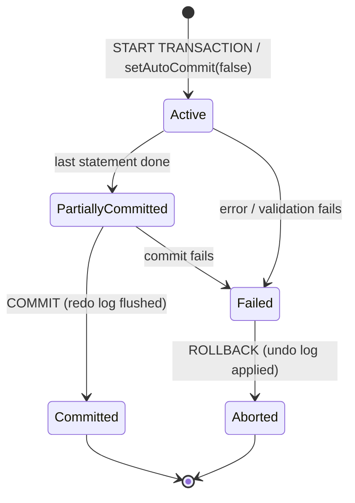
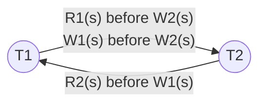

# Transactions, Concurrency and Recovery

## 1. ACID in this project

| Property | What it means here | How it is achieved |
|---|---|---|
| **Atomicity** | An order, its items, the stock reduction and the payment are saved together or not at all | JDBC `setAutoCommit(false)` … `commit()` / `rollback()` in `OrderService.placeOrder` |
| **Consistency** | Stock never negative, totals equal line totals, statuses valid | `CHECK`/FK constraints + Java validation; `fn_order_total` confirms totals |
| **Isolation** | Two buyers cannot both take the last units | `SELECT … FOR UPDATE` row locks (InnoDB, REPEATABLE READ) |
| **Durability** | A committed order survives a restart or crash | InnoDB redo log flushed at commit (`innodb_flush_log_at_trx_commit = 1`, the default) |

## 2. Transaction states



## 3. The order transaction

[`OrderService.placeOrder`](../src/main/java/service/OrderService.java)
follows the brief's §14.2 steps:

| # | Step | Code |
|---|---|---|
| 1 | Begin | `con.setAutoCommit(false)` |
| 2 | Read **and lock** every product row, in product-id order | `OrderDAO.lockProduct` → `SELECT … FROM product … WHERE product_id = ? FOR UPDATE OF p` |
| 3 | Re-check each product: still ACTIVE, seller verified, **price unchanged**, enough stock | `checkStillOrderable` → `InsufficientStockException` |
| 4 | Group the cart by farm; for each farm insert the order header with a total computed from **database** prices | `insertOrder` |
| 5 | Insert the items with the price at purchase time | `insertItem` |
| 6 | Reduce stock (and mark OUT_OF_STOCK at zero) | `reduceStock` |
| 7 | Insert the (simulated) payment | `insertPayment` |
| 8 | Commit | `con.commit()` |
| 9 | Any exception → roll back everything | `catch (…) { con.rollback(); throw e; }` |

The same pattern is used for cancel/reject (restore stock, refund payment)
and every admin change.

## 4. Schedules: two buyers, the last units of Turmeric

Turmeric has **8 kg**. T1 (Priya) wants 6 kg, T2 (FreshMart) wants 5 kg.
`R(s)` = read stock, `W(s)` = write stock.

### Schedule S1 — interleaved, no locking (what would happen without `FOR UPDATE`)

| Time | T1 | T2 | stock |
|---|---|---|---|
| 1 | R₁(s) → 8 | | 8 |
| 2 | | R₂(s) → 8 | 8 |
| 3 | 6 ≤ 8 ✓ W₁(s = 8 − 6) | | 2 |
| 4 | | 5 ≤ 8 ✓ W₂(s = 8 − 5) | **3** |
| 5 | commit | commit | 3 |

Both orders are accepted: **11 kg sold from 8 kg**, and T1's write is lost
(**lost update**).

**Conflicting operations** (same item, different transactions, at least one
write): R₁(s)–W₂(s), R₂(s)–W₁(s), W₁(s)–W₂(s).

**Precedence graph** — an edge Tᵢ → Tⱼ when an operation of Tᵢ conflicts with
and comes before one of Tⱼ:



The graph has a **cycle**, so S1 is **not conflict-serializable**: no serial
order (T1 then T2, or T2 then T1) produces the same result.

It is not **view-serializable** either: in S1 both transactions read the
initial value of s, but in any serial schedule one of them would read the
value written by the other. (Every conflict-serializable schedule is
view-serializable; the converse only fails for schedules with blind writes,
which this one does not have.)

### Schedule S2 — what actually happens (`SELECT … FOR UPDATE`)

| Time | T1 | T2 | stock |
|---|---|---|---|
| 1 | X-lock(s), R₁(s) → 8 | | 8 |
| 2 | | requests X-lock(s) … **waits** | 8 |
| 3 | 6 ≤ 8 ✓ W₁(s) | (waiting) | 2 |
| 4 | commit, **release lock** | | 2 |
| 5 | | X-lock granted, R₂(s) → **2** | 2 |
| 6 | | 5 > 2 ✗ `InsufficientStockException`, rollback | 2 |

The precedence graph has only T1 → T2: **no cycle**, so S2 is
conflict-serializable and equivalent to the serial schedule T1, T2.

This is **strict two-phase locking**: a transaction acquires its locks while
it runs (growing phase) and releases them all only at commit/rollback
(shrinking phase). InnoDB guarantees serializable *results* for the rows it
locks.

**Evidence.** Run during development (24 Nov 2026) on a throwaway database:
two Java threads placed orders for 4 of the last 5 kg of Turmeric at the same
instant (a `CountDownLatch` released both). Result: *Priya — placed order
[9]; FreshMart — rejected (insufficient stock)*; final stock 1.00 kg.
[`concurrency_demo.sql`](../database/demo/concurrency_demo.sql) lets you
reproduce S2 by hand in two terminals.

## 5. Locks, isolation levels and deadlocks

**Lock types.** A *shared* (S) lock allows others to read but not write; an
*exclusive* (X) lock blocks other locking reads and writes. `FOR UPDATE`
takes X locks, `FOR SHARE` takes S locks. Plain `SELECT` takes no lock at all
in InnoDB — it reads a consistent snapshot (MVCC).

**Isolation levels** (InnoDB default: **REPEATABLE READ**, confirmed by
`SELECT @@transaction_isolation`):

| Level | Dirty read | Non-repeatable read | Phantom read |
|---|---|---|---|
| READ UNCOMMITTED | possible | possible | possible |
| READ COMMITTED | prevented | possible | possible |
| REPEATABLE READ (InnoDB default) | prevented | prevented | prevented for locking reads (next-key locks); plain reads use one snapshot |
| SERIALIZABLE | prevented | prevented | prevented |

Important detail: in REPEATABLE READ a *plain* `SELECT` would show T2 the old
snapshot (8 kg) — exactly the wrong value. A *locking* read (`FOR UPDATE`)
always reads the **latest committed** row, which is why T2 sees 2 kg in S2.
That is the reason the application locks instead of relying on the
isolation level alone.

**Deadlocks.** If T1 locks Tomato then Onion while T2 locks Onion then Tomato,
each waits for the other forever. InnoDB detects the cycle in its wait-for
graph and rolls back one transaction (error 1213). The application **avoids**
this by always locking products in ascending `product_id` order
(`items.sort(Comparator.comparingInt(…getProductId))`), so a cycle cannot form.

**Pessimistic vs optimistic.** This project is *pessimistic*: lock first,
then check. An *optimistic* alternative is a conditional update —
`UPDATE product SET available_quantity = available_quantity - ? WHERE product_id = ? AND available_quantity >= ?`
— and treating "0 rows updated" as "out of stock". It needs no explicit lock
but cannot re-check price and status as easily, and gives a less precise
message to the buyer.

**Buyer cancels while the farmer accepts.** Both operations start by locking
the *order* row (`lockOrder … FOR UPDATE`), so they run one after the other.
Tested five times with two threads: every run ended in a valid state
(either "cancel OK, accept refused", or accept first and then a cancel that
is still allowed for a confirmed order).

## 6. Rollback after a failure midway (test T09)

To prove atomicity, a temporary trigger made the insert of the Toor Dal line
fail. The cart held Tomato (Patil) and Toor Dal (Deshmukh), so the first
farm's order had **already been inserted and its stock reduced** when the
second order failed.

```
placeOrder failed: Could not place the order / cause: T09 simulated failure while inserting an order line
Priya's orders before/after:  2 / 2
Tomato stock before/after:    450.00 / 450.00
Toor Dal stock before/after:  270.00 / 270.00
orders in the table: 5   next AUTO_INCREMENT for orders: 9
```

Everything was undone. The gap in order ids shows the rows really were
written before the rollback: `AUTO_INCREMENT` values are not reused after a
rollback (by design, so concurrent inserts never wait for each other).

## 7. Recovery

**Logs.**

* **Redo log** (write-ahead log): every change is first written to the redo
  log; at commit the log is flushed to disk. After a crash, InnoDB replays the
  redo log to restore committed changes whose data pages were not yet written.
* **Undo log**: old versions of changed rows. Used for `ROLLBACK`, for
  undoing uncommitted transactions after a crash, and for MVCC snapshots.
* **Binary log**: a log of committed changes used for replication and
  point-in-time recovery (enabled by default in MySQL 8.4).

**Checkpoints.** InnoDB writes changed ("dirty") pages from the buffer pool to
the data files in the background (*fuzzy checkpointing*) and records how far
the redo log is covered. Recovery only has to replay the log after the last
checkpoint.

**After a crash:** committed work is redone from the redo log; work that was
not committed is rolled back from the undo log. So an order whose `commit()`
returned is never lost, and a half-finished order never appears.

**Backup and restore (test T16).**
[`scripts/backup.ps1`](../scripts/backup.ps1) runs
`mysqldump --single-transaction --routines --triggers`.
`--single-transaction` starts a REPEATABLE READ snapshot, so the dump is
consistent without locking the tables while the app runs.
[`scripts/restore.ps1`](../scripts/restore.ps1) restores into a **separate**
database (`farmer_marketplace_restore_test`) — recovery is never tested on the
only copy — and compares row counts:

| Table | live | restored |
|---|---|---|
| users | 7 | 7 |
| product | 12 | 12 |
| orders | 5 | 5 |
| order_item | 8 | 8 |
| payment | 5 | 5 |
| … all 13 tables | match | match |
| routines + triggers | 8 | 8 |

In the restored copy the stored procedure ran and the price-history trigger
fired, so the routines came back working, not just present.
